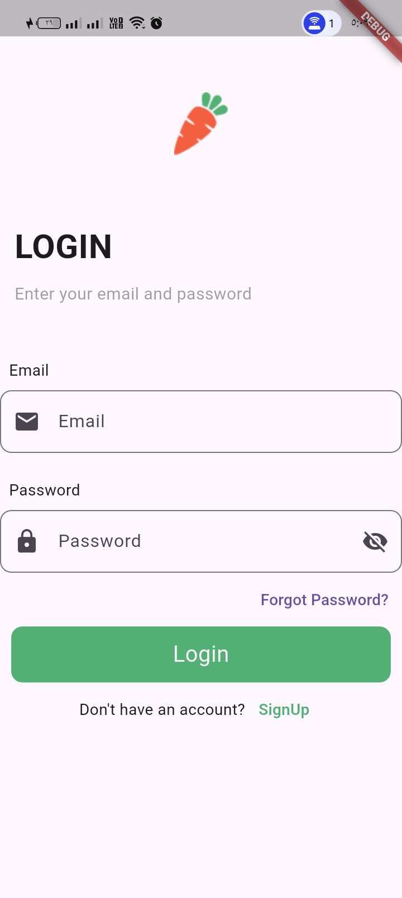
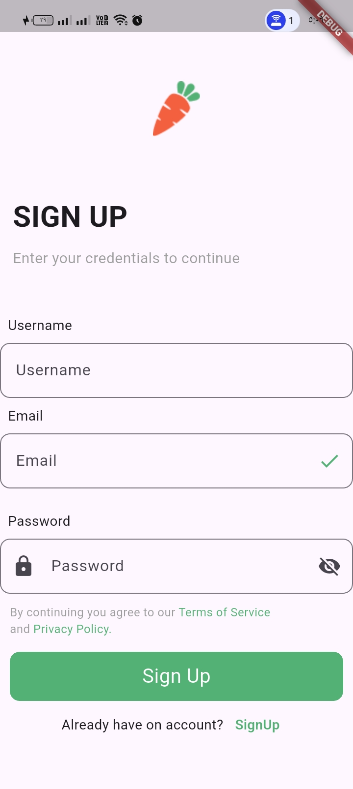
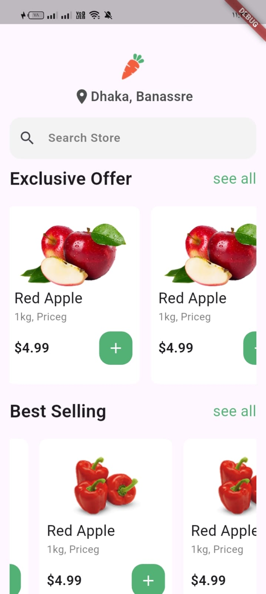
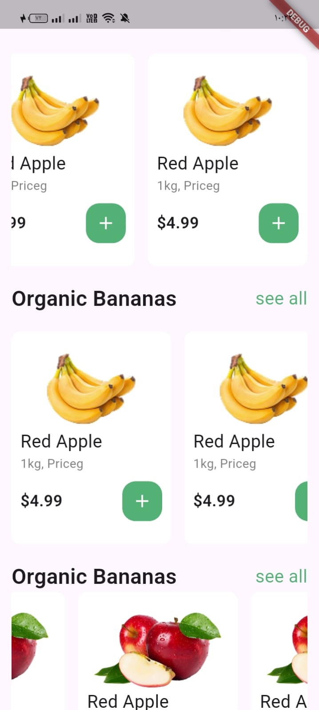
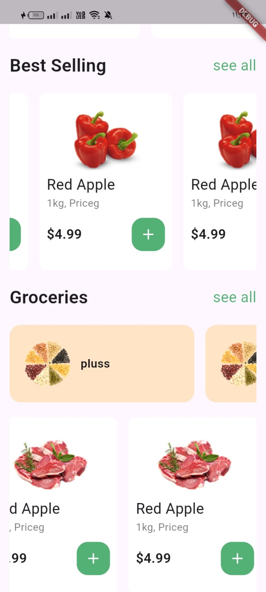

# First App UI

A Flutter application showcasing my UI development skills using Flutter.

##  Screenshots

<p align="center">
  
  
</p>

<p align="center">
  
  
</p>

<p align="center">
  
</p>

## 🛠 Built With

- Flutter
- Dart

##  Getting Started

Clone the repository:

```bash
git clone YOUR_REPOSITORY_URL
```

Install dependencies:

```bash
flutter pub get
```

Run the application:

```bash
flutter run
```

##  Resources

- [Learn Flutter](https://docs.flutter.dev/get-started/learn-flutter)
- [Write Your First Flutter App](https://docs.flutter.dev/get-started/codelab)
- [Flutter Documentation](https://docs.flutter.dev/)